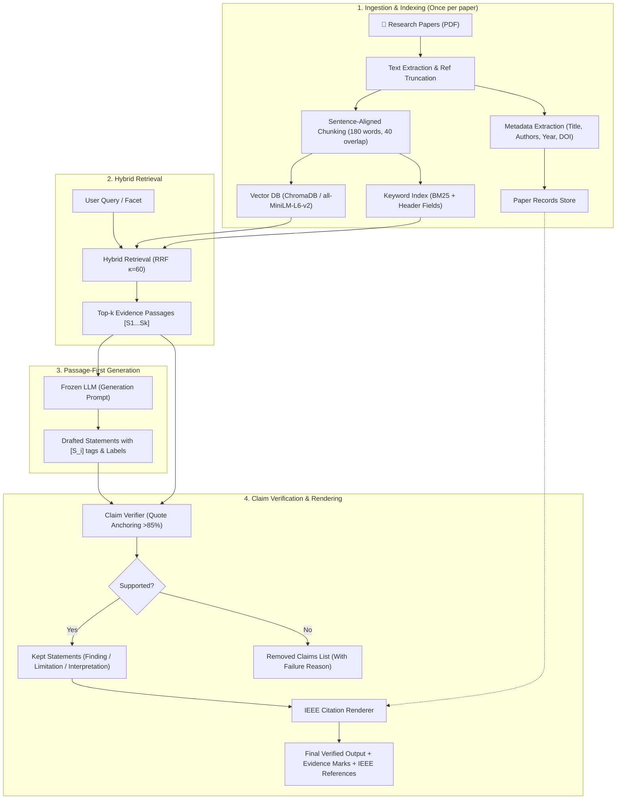

# 📑 Evidence-Grounded Generative AI for Engineering Research Document Citation

[](https://www.python.org/downloads/)
[](https://streamlit.io)
[](https://www.trychroma.com/)
[](https://opensource.org/licenses/MIT)
[]()
[]()

> **An evidence-grounded research assistant that only says what it can prove.** It reads engineering research PDFs, answers across three dedicated modes, links every factual claim to an exact passage, verifies claims with quote anchoring, and automatically removes unverified statements. **Zero model training or fine-tuning required.**

---

## 📌 Table of Contents
- [Overview](#-overview)
- [The Problem vs. Our Solution](#-the-problem-vs-our-solution)
- [Key Features](#-key-features)
- [System Architecture](#-system-architecture)
- [Design Principles](#-design-principles)
- [Project Structure](#-project-structure)
- [Getting Started](#-getting-started)
  - [Prerequisites](#prerequisites)
  - [Installation](#installation)
  - [Environment Configuration](#environment-configuration)
- [Running the Application](#-running-the-application)
  - [Web Interface (Streamlit)](#1-interactive-web-application)
  - [Command-Line Interface (CLI)](#2-command-line-interface-cli)
- [Automated Testing & Evaluation](#-automated-testing--evaluation)
- [Research Paper & Citation](#-research-paper--citation)
- [License](#-license)

---

## 🔬 Overview

Engineering students and researchers read dozens of complex research papers every semester. While commercial Generative AI tools (ChatGPT, Gemini, Copilot) are frequently used to summarize and query papers, they suffer from two critical flaws:
1. **Fabricated Citations (Factuality Hallucination)**: LLMs invent paper titles, non-existent authors, wrong publication years, and fake DOIs (GPT-3.5 fabricates ~55% and GPT-4 ~18% of references).
2. **Conflated Interpretations (Faithfulness Hallucination)**: LLMs blend what the author actually found with the model's own guesses and inferences without distinguishing between them.

**Evidence-Grounded Citation (EGC)** closes this gap by enforcing a strict **passage-first generation** and **post-hoc claim verification** pipeline that anchors every claim to indexed PDF passages, drops unsupported claims, and prints citations directly from extracted metadata.

---

## ⚖️ The Problem vs. Our Solution

| Capability | Standard LLM / Naive RAG | Evidence-Grounded AI (This System) |
| :--- | :--- | :--- |
| **Citation Source** | Generated from model memory (hallucination-prone) | **Extracted & verified from PDF / Crossref / arXiv** |
| **Claim Attribution** | Document-level or none | **Sentence-level anchored to specific passage chunk** |
| **Faithfulness Check** | None (assumes output is correct) | **Post-hoc NLI verifier with >85% quote overlap check** |
| **Unsupported Claims** | Presented confidently to the user | **Automatically purged and isolated in a removed list** |
| **Statement Labels** | Monolithic text block | **Explicitly split: Findings 🟢, Limitations 🔴, Interpretations 🟠** |
| **Model Requirements** | Requires custom fine-tuning or proprietary agents | **Training-free, runs on any frozen LLM (Groq, Gemini, Ollama)** |

---

## ✨ Key Features

* **🛡️ Zero-Hallucination Metadata Engine**: Paper titles, authors, publication years, and DOIs are never generated by an LLM. Bibliographic records are parsed at ingestion, validated against Crossref / arXiv, and printed in IEEE citation format.
* **⚡ Hybrid Dense + Sparse Retrieval**: Combines sentence embeddings (`sentence-transformers/all-MiniLM-L6-v2` via ChromaDB) with BM25 keyword matching via **Reciprocal Rank Fusion (RRF, $\kappa=60$)**, capturing both semantic intent and exact identifiers (DOIs, author names).
* **🎯 Three Dedicated Modes**:
  * **Ask Research**: Cross-paper synthesis answering technical questions across all ingested papers.
  * **Explain Paper**: Deep-dive into a single paper explaining methodology, results, and concepts in plain language.
  * **Summarize Paper**: Structured 6-facet breakdown (*Objective, Method, Data & Setup, Results, Limitations, Takeaway*).
* **🔍 Quote-Anchored Post-Hoc Verification**: Every claim–passage pair is audited. If the verifier cannot locate the exact supporting text span ($>85\%$ token overlap) within the retrieved chunk, the claim is removed.
* **🎨 Modern Glassmorphic Streamlit UI**: High-tech responsive dashboard with dynamic ambient nebula backgrounds, micro-dot matrix textures, frosted glass sidebar, metrics cards, and a real-time theme switcher (*Cosmic Aurora*, *Deep Space Slate*, *Emerald Cyber*, *Paper Clean*).
* **📊 Plain LLM Baseline Comparison**: Interactive side-by-side mode comparing the evidence-grounded response against an ungrounded LLM response to clearly demonstrate hallucination mitigation.

---

## 🏗️ System Architecture



---

## 📐 Design Principles

1. **Citations are Copied, Never Generated**: The LLM is forbidden from writing author names, titles, or DOIs. Citations are linked via integer tags (`[1]`, `[2]`) that resolve to stored metadata.
2. **Closed-Tag Space**: The model may only cite passage tags present in its immediate context. Any hallucinated tag is discarded at parse time.
3. **Delete, Don't Rewrite**: If a claim fails verification, it is deleted rather than regenerated. Rewriting risks introducing secondary hallucinations.
4. **Honest Abstention**: If retrieved passages lack sufficient evidence, or if all claims fail verification, the system returns an explicit abstention (`"The uploaded papers do not contain sufficient evidence to answer this question."`).

---

## 📂 Project Structure

```
evidence-grounded-citation/
├── egc/                        # Core Engine Package
│   ├── cli.py                  # Command-line interface
│   ├── config.py               # Pydantic configuration & environment settings
│   ├── embeddings.py           # Dense sentence-transformer embedder
│   ├── generate.py             # Passage-first drafting logic
│   ├── ingest.py               # PDF parser, ref-cutter, & chunker
│   ├── llm.py                  # OpenAI-compatible API client & rate limiter
│   ├── metadata.py             # Crossref, arXiv, and PDF metadata extractors
│   ├── pipeline.py             # Engine orchestrator for Ask / Explain / Summarize
│   ├── prompts.py              # System & task prompts enforcing ground rules
│   ├── render.py               # IEEE citation formatter & numbering
│   ├── retrieve.py             # Hybrid dense + BM25 reciprocal rank fusion
│   ├── schema.py               # Pydantic data schemas (Paper, Chunk, Statement)
│   ├── store.py                # ChromaDB + BM25 persistence layer
│   ├── textutil.py             # Text cleaning and word wrapping utilities
│   └── verify.py               # Post-hoc claim verifier with quote anchoring
├── eval/                       # Evaluation & Benchmark Harness
│   ├── corpus/                 # Pre-ingested open-access evaluation corpus
│   ├── download_corpus.py      # Automated arXiv paper downloader
│   ├── metrics.py              # ALCE, RAGAS, citation precision/recall metrics
│   ├── run_eval.py             # Automated benchmark evaluator
│   └── make_report.py          # LaTeX results table & summary generator
├── paper/                      # Research Paper LaTeX Source & Figures
│   ├── architecture.png        # System architecture diagram
│   ├── architecture.tex        # TikZ standalone architecture source
│   ├── sections_III_to_V.tex   # Paper Part 2 (Methodology, Results, Future Work)
│   └── generated/              # LaTeX results macros generated from eval runs
├── papers/                     # Directory for uploaded user PDFs
├── store/                      # Persistent ChromaDB vector DB & metadata JSON
├── tests/                      # Automated Test Suite (Pytest)
│   ├── test_pipeline.py        # End-to-end engine tests with mock model
│   └── test_eval_smoke.py      # Evaluation pipeline integrity checks
├── .streamlit/
│   └── config.toml             # Streamlit theme & UI layout configuration
├── app.py                      # Interactive Streamlit Web Application
├── requirements.txt            # Python dependencies
├── .env.example                # Example environment configuration
└── README.md                   # Project documentation
```

---

## 🚀 Getting Started

### Prerequisites
* Python 3.10, 3.11, or 3.12
* Windows, macOS, or Linux
* An API key for any OpenAI-compatible provider (Groq, Google Gemini, OpenRouter) or a local [Ollama](https://ollama.ai) instance.

### Installation

1. **Clone the repository**:
   ```bash
   git clone https://github.com/Kart-1692/CiteSure.git
   cd evidence-grounded-citation
   ```

2. **Create and activate a virtual environment**:
   ```bash
   # Windows (PowerShell)
   python -m venv .venv
   .\.venv\Scripts\Activate.ps1

   # Linux / macOS
   python3 -m venv .venv
   source .venv/bin/activate
   ```

3. **Install dependencies**:
   ```bash
   pip install -r requirements.txt
   ```

### Environment Configuration

Copy `.env.example` to `.env`:
```bash
cp .env.example .env
```

Open `.env` and configure your LLM provider. For example, using **Groq** (free & ultra-fast):
```env
EGC_LLM_BASE_URL=https://api.groq.com/openai/v1
EGC_LLM_API_KEY=gsk_your_groq_api_key_here
EGC_LLM_MODEL=llama-3.3-70b-versatile
EGC_LLM_MIN_INTERVAL=2.0
```

> [!TIP]
> To list models available on your configured endpoint, run:
> ```bash
> python -m egc.cli models
> ```

---

## 💻 Running the Application

### 1. Interactive Web Application

Launch the Streamlit interface:
```bash
streamlit run app.py
```
Open `http://localhost:8501` in your browser.

* **Sidebar**: Ingest new PDFs, view chunking statistics, inspect paper metadata, or toggle background themes (*Cosmic Aurora*, *Deep Space Slate*, *Emerald Cyber*, *Paper Clean*).
* **Tabs**:
  1. **Ask Research**: Query across all uploaded engineering papers.
  2. **Explain Paper**: Deep-dive into a paper's method, results, and limitations.
  3. **Summarize Paper**: Generate an IEEE-structured 6-section breakdown.
* **Baseline Comparison**: Toggle `"Also show the plain LLM answer"` in the sidebar to compare evidence-grounded answers against ungrounded model outputs side-by-side.

### 2. Command-Line Interface (CLI)

```bash
# Ingest all PDFs in the papers/ directory with online metadata enrichment
python -m egc.cli ingest papers/ --enrich

# List all indexed papers and chunk statistics
python -m egc.cli list

# Ask a question across all papers
python -m egc.cli ask "How does the proposed controller mitigate sensor noise?"

# Explain a specific paper
python -m egc.cli explain "Self-RAG" --focus "reflection tokens"

# Summarize a paper
python -m egc.cli summarize "Chain-of-Verification"

# Run plain baseline LLM for comparison
python -m egc.cli baseline ask "same question"
```

---

## 🧪 Automated Testing & Evaluation

### Running Tests
The project includes a suite of offline unit tests utilizing synthetic PDFs, a scripted mock model, and a hashing embedder:
```bash
pytest -q
```
Expected output:
```
.........                                                                [100%]
9 passed in ~7s
```

### Running the Evaluation Benchmark (ALCE / RAGAS)
To run the full evaluation comparing **Plain LLM vs. Draft vs. Verified**:
```bash
# 1. Download 12 open-access arXiv benchmark papers
python -m eval.download_corpus

# 2. Run evaluation (resumable, cached in results/raw/)
python -m eval.run_eval --limit 5

# 3. Generate LaTeX results tables and summary report
python -m eval.make_report
```

---

## 📑 Research Paper & Citation

This codebase is the experimental implementation of the research paper:

> **Evidence-Grounded Generative AI Model for Engineering Research Document Citation**  
> *Kartikey Mani Tripathi, Bayya Venkata Anvesh, Anish Dattatraya Tabib, and Dr. Evangeline D*  
> Department of Information Science and Engineering,  
> M S Ramaiah Institute of Technology, Bengaluru, India.

If you find this work or codebase helpful in your research, please cite:

```bibtex
@article{tripathi2026evidence,
  title   = {Evidence-Grounded Generative AI Model for Engineering Research Document Citation},
  author  = {Tripathi, Kartikey Mani and Anvesh, Bayya Venkata and Tabib, Anish Dattatraya and Evangeline, D.},
  journal = {Department of Information Science and Engineering, M S Ramaiah Institute of Technology},
  year    = {2026}
}
```

---

## 📄 License

This project is licensed under the **MIT License** — see the [LICENSE](LICENSE) file for details.
